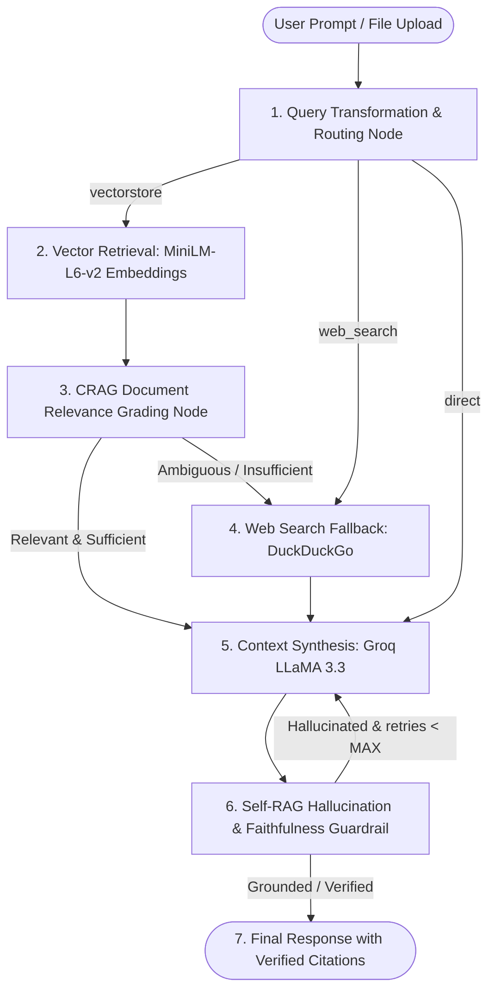

# Self-Corrective & Adaptive Agentic RAG (CRAG + Self-RAG Pattern)

[](.github/workflows/ci-cd.yml)
[](https://www.python.org/)
[](https://fastapi.tiangolo.com)
[](https://langchain-ai.github.io/langgraph/)
[](https://react.dev)
[](https://github.com/pgvector/pgvector)
[](https://groq.com)
[](https://huggingface.co)

A production-grade, state-machine orchestrated **Agentic Retrieval-Augmented Generation (RAG)** application. Designed to eliminate hallucinations, filter out noisy vector chunks, dynamically supplement incomplete knowledge via real-time web search, and verify groundedness before delivering responses.

---

## 🏛️ System Architecture



---

## ⚡ Key Highlights

- **Adaptive Query Routing & Decomposition**: Analyzes question intent, rewrites conversational ambiguities, and decomposes complex queries into focused sub-queries.
- **Corrective RAG (CRAG)**: Evaluates candidate chunks with relevance grading (`relevant`, `ambiguous`, `irrelevant`). Prunes out noise and automatically triggers external web search fallback when context is insufficient.
- **Self-RAG Post-Generation Guardrails**: Strict evaluation checks answer groundedness against retrieved context. Loops back to self-correct if hallucinations or ungrounded assertions are detected.
- **100% Free Local Embeddings**: Powered by Hugging Face `sentence-transformers/all-MiniLM-L6-v2` (384 dimensions) running locally on CPU. Zero API costs, zero rate limits.
- **Ultra-Fast Generation**: Powered by Groq Cloud API with `llama-3.3-70b-versatile` or `llama-3.1-8b-instant`.
- **PostgreSQL + pgvector Database**: Native SQL vector search with HNSW index, plus automated fallback to local persistent ChromaDB. Includes pgAdmin 4 for graphical database management.
- **Interactive React Studio**: Modern dark-mode glassmorphism interface featuring drag-and-drop document uploads, real-time Server-Sent Events (SSE) streaming, expandable citation cards, and a live LangGraph state machine execution visualizer.
- **End-to-End CI/CD**: Automated GitHub Actions workflow testing Python 3.12 backend, React frontend build, and Docker containers.

---

## 📁 Repository Structure

```
Self_Corrective_Rag/
├── .github/
│   └── workflows/
│       └── ci-cd.yml             # GitHub Actions CI/CD Pipeline
├── backend/
│   ├── app/
│   │   ├── api/                  # FastAPI REST & SSE Streaming Routes
│   │   ├── ingestion/            # PDF, DOCX, TXT parser & chunker
│   │   ├── models/               # Pydantic schemas
│   │   ├── rag/                  # LangGraph State Machine & CRAG/Self-RAG nodes
│   │   ├── config.py             # App settings & environment variables
│   │   ├── database.py           # PostgreSQL pgvector & ChromaDB manager
│   │   └── main.py               # FastAPI entrypoint
│   ├── tests/                    # Pytest test suite (100% pass)
│   └── Dockerfile                # Python 3.12 backend container
├── frontend/
│   ├── src/
│   │   ├── components/           # Navbar, Chat, Visualizer, Ingestion, Citations
│   │   ├── services/             # API & SSE streaming client
│   │   ├── styles/               # Obsidian glassmorphic design system
│   │   └── App.jsx               # Main React application
│   ├── package.json
│   ├── vite.config.js
│   ├── Dockerfile
│   └── nginx.conf
├── docker-compose.yml             # PostgreSQL (pgvector) + pgAdmin + Backend + Frontend
├── .env.example                   # Environment configuration template
├── cmd.txt                        # Complete CLI commands & concepts reference
└── requirements.txt               # Backend dependencies for Python 3.12
```

---

## 🚀 Quickstart Guide

### 1. Prerequisites
- Python 3.12+
- Node.js 18+ and npm
- (Optional) Docker & Docker Compose for PostgreSQL + pgAdmin

### 2. Configure Environment Variables
Copy `.env.example` to `.env`:
```bash
cp .env.example .env
```

Open `.env` and configure your credentials:
```env
# >>> USER INSERTION MARKERS <<<
GROQ_API_KEY=gsk_your_groq_api_key_here
GROQ_MODEL=llama-3.3-70b-versatile

# PostgreSQL & pgAdmin credentials:
POSTGRES_USER=postgres
POSTGRES_PASSWORD=postgres
POSTGRES_HOST=localhost
POSTGRES_PORT=5432
POSTGRES_DB=rag_db
```

> **Note**: If you don't have PostgreSQL running locally yet, the app **automatically and safely falls back to local ChromaDB**, allowing you to ingest files and chat immediately without database connection errors!

---

### 3. Local Development Setup

#### Backend:
```bash
# 1. Activate virtual environment
.\.venv\Scripts\Activate.ps1    # Windows PowerShell
source .venv/bin/activate       # Linux / macOS

# 2. Run FastAPI server
$env:PYTHONPATH="backend"
python -m uvicorn app.main:app --reload --port 8000
```
API Documentation will be live at: [http://localhost:8000/docs](http://localhost:8000/docs)

#### Frontend:
```bash
cd frontend
npm install
npm run dev
```
Frontend Studio will be live at: [http://localhost:5173](http://localhost:5173)

---

### 4. Running with Docker Compose (Full Stack)

Start all services (PostgreSQL with pgvector, pgAdmin 4, Backend, and Frontend):
```bash
docker compose up --build -d
```

Access endpoints:
- **Frontend Web UI**: [http://localhost:3000](http://localhost:3000)
- **Backend API Docs**: [http://localhost:8000/docs](http://localhost:8000/docs)
- **pgAdmin 4 Dashboard**: [http://localhost:5050](http://localhost:5050)
  - Login: `admin@rag.local` / `admin_secret`
- **PostgreSQL Database**: `localhost:5432`

---

## 🧪 Running Automated Tests

Run backend unit tests:
```bash
$env:PYTHONPATH="backend"
python -m pytest backend/tests -v
```

Build frontend production bundle:
```bash
cd frontend
npm run build
```

---

## 📄 License
MIT License. Open-source for personal and commercial usage.